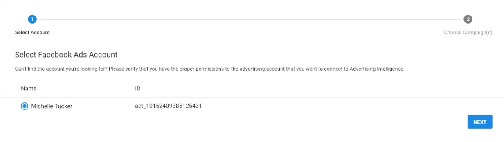

With the Advanced Reporting add-on, you can connect individual ad campaigns to your Advertising Intelligence account. This feature allows you to selectively display specific campaigns in your reporting table. It's ideal for multi-location businesses that want to show only the campaigns relevant to a specific location.

## Why is connecting individual ad campaigns important?

When connecting a Google Ads, Facebook Ads, or Microsoft Ads account, you can connect and display a specified list of individual campaigns in the reporting table. This is useful for multi-location businesses, letting you display metrics relevant to the appropriate account so you can view proof of performance for only the campaigns that relate to a specific location.

## How does connecting individual ad campaigns work?

### With Advanced Reporting activated

1. Go to `Advertising Intelligence` → `Settings` → `Connections`
2. On the Google Ads, Facebook Ads, or Microsoft Ads card, click `Connect`
3. In the pop-up window, choose the Ad account you want to connect to your Advertising Intelligence account
4. Click `Next`
5. To connect to individual campaigns, check the box next to `Connect to individual campaigns`
6. A list of currently active campaigns appears below. Check the box next to each campaign you want to display for this Advertising Intelligence account

:::info
Only the campaigns you select display, and any future campaigns created won't display for this account. Disconnect and reconnect your account to display them.
:::

## To connect an ad account and all active campaigns

1. Go to `Advertising Intelligence` → `Settings` → `Connections`
2. On the Google Ads, Facebook Ads, or Microsoft Ads card, click `Connect`
3. In the pop-up window, choose the Ad account you want to connect to your Advertising Intelligence account
4. Click `Next`
5. Select `Connect Account`

:::info
All currently active campaigns connect, and any future campaigns you create connect automatically.
:::

## Who gets it?

You get this feature if you have Advertising Intelligence with the Advanced Reporting add-on.