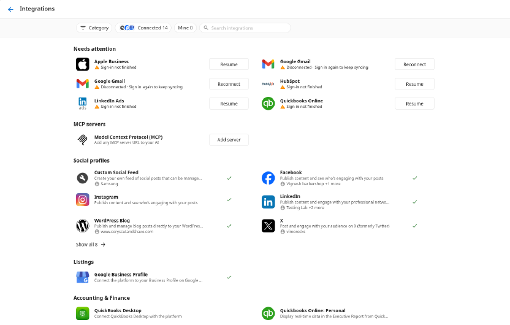
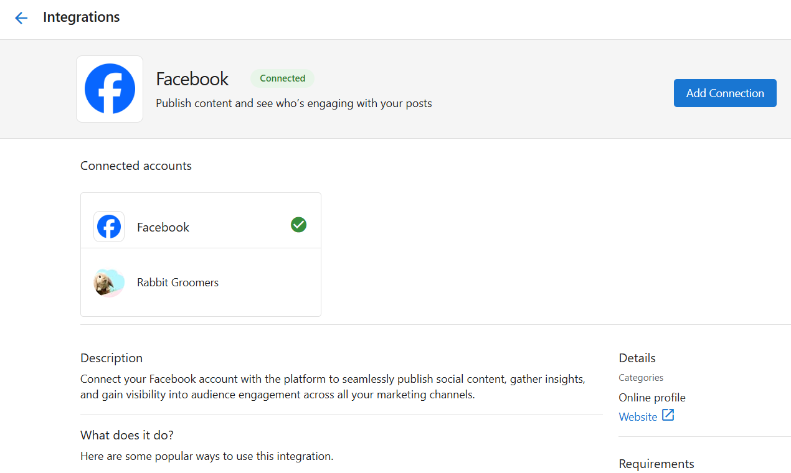
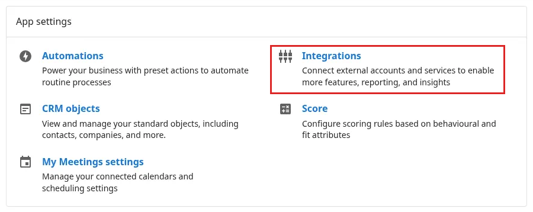

## What can I manage in Integrations?
The **Integrations** section allows you to link third-party tools directly to your app. These integrations bring your most important business data into one place and allow services across your app to work together.

By connecting platforms like Google, Facebook, and others, you can:

- Sync location, lead, or campaign data  
- Power reporting tools like the Executive Report and Marketing Funnel  
- Enable automations and trigger workflows  
- Improve communication and scheduling with customers

Integrations are shared across most activated products.

## Why are integrations important?
When your tools are connected, your app can use real data to show what's working. Integrations help you track marketing performance and trigger smart actions, such as sending review requests or appointment reminders.

Connecting accounts also reduces manual work by automatically syncing data between systems, improving the accuracy and efficiency of your daily operations.

## What is included?
The Integrations page shows every integration in one list. A `Needs attention` section comes first if any connections need fixing, followed by MCP servers, then one section for each integration category. Each section shows six integrations at a time, connected ones first, with a `Show all` option to see the rest.

Common integrations include:

### Google and Meta platforms
- **Google Business Profile** – Syncs location details and visibility metrics  
- **Google Analytics** – Tracks site activity and marketing performance  
- **Google Search Console** – Adds search insights
- **Facebook** – For reporting and automation  

### Scheduling and service tools
- **Housecall Pro** – Syncs job scheduling and service activity  
- **Jobber** – Connects field service workflows  
- **Gingr**, **PetExec**, **Pet Resort Pro**, **Paw Partner** – Connect customer and service data for pet-related businesses  

### CRM tools
- **HubSpot** – Two-way sync for Contacts and Companies between HubSpot and Business App

### Finance and productivity tools
- **QuickBooks Online / Personal** – Syncs invoices, transactions, and billing data
- **Zapier** – Connects and automates workflows with thousands of apps  

## How to browse and add new integrations
1. Go to `Administration` in your side bar. 
2. Select `Integrations`.  
3. Find the integration you want by scrolling through its category section, selecting a `Category` filter, or searching by name.  
4. Hover or focus on the integration's row and select `Connect`. A green check mark shows once it's connected.  
5. Follow the steps to authorize your account.

Each integration has its own required steps to connect. Once connected, data will begin syncing automatically into your app (some integrations will take up to 48 hours to sync).

### Connecting more than one account
You can connect more than one account to the same integration — for example, two Gmail inboxes or two Shopify stores. Working accounts share one row, shown as a name with a count of how many more are connected (for example, "amanda@… +2 more"). On a connected row, select `Add` to connect another account, up to the integration's limit. If none of your existing accounts work for the new connection, a separate `Connect` row appears instead.

### Filters and search
Use the `Category` filter to narrow the list to one category, the `Connected` filter to show only integrations you've already connected, or the `Mine` filter to show only the connections you made yourself. Search looks at integration names, descriptions, and category names.

Your chosen filters stay in the page link, so you can copy and share a filtered view. Going back from an integration's page returns you to the same filtered view you started from.

On a phone, categories open in a bottom sheet, and search expands from an icon.

### Adding an MCP server
Select `Add server` in the MCP servers section to add a new server.

## Types of integrations

Your app supports three different methods of connecting external platforms. Each method serves a different use case depending on how the integration is built, who manages it, and how it’s authenticated. Understanding these types will help you navigate set up for the connection you are working with. 

| **Integration Type**  | **Best For**                             | **Setup Method**                |
|-----------------------|-------------------------------------------|----------------------------------|
| **Vendor-Managed**    | Prebuilt connections                      | Log in and connect               |
| **SSO-Based**         | Secure logins and synced data             | Single sign-on authorization     |
| **API-Key Based**     | Custom or advanced external connections   | Generate and use API credentials |

Within each specific app (after you select `Add Connection`) you are prompted with special instructions on how to navigate and set up the connection. 

## How to manage or disconnect integrations
1. From the `Integrations` page, turn on the `Connected` filter to see only what you've connected, or the `Mine` filter to see only the connections you made yourself.
2. Select an integration to see its connected accounts, including who connected each one.
3. From there, you can:
   - Reconnect an account if authorization has expired  
   - Disconnect the platform  

If a connection is broken, it shows up in `Needs attention` at the top of the page and on its own row, with `Reconnect` or `Resume` and the reason, right on the row.

## What data gets synced
Each integration sends specific data to your app, depending on its purpose. For example:

- **Lead forms** from Facebook  
- **Website performance** from Google Analytics  
- **Search visibility** from Google Business Profile  
- **Customer and job data** from Housecall Pro or Jobber  
- **Contacts and Companies** from HubSpot (two-way sync: changes in either system update the other within minutes)
- **Financial records** from QuickBooks 

## Quick access

You can access the Integrations page directly from `Administration` > `Integrations`.

Connecting your accounts early is one of the most important steps you can take to start seeing value in Business App. The metrics pulled in through Integrations power analytics in the Executive Report and Marketing Funnel.

## Frequently Asked Questions (FAQs) {#frequently-asked-questions-faqs}

What does the HubSpot integration sync?

The HubSpot integration keeps Contacts and Companies in sync between HubSpot and Business App. Any updates made in one platform automatically appear in the other within minutes.

How do I connect HubSpot?

Go to `Administration` → `Integrations`, find HubSpot, and click `Add Connection`. Choose your sync options, then authorize the connection using your HubSpot account. If you only have one HubSpot account available, it's selected automatically.

Will deleting a record in HubSpot delete it in Business App?

No. Deletions in one system do not automatically remove records in the other.

How do I reconnect an integration that has expired?

Look in `Needs attention` at the top of `Administration` > `Integrations` and select `Reconnect` or `Resume` on the integration's row, then follow the prompts to reauthorize.

Can I disconnect an integration without losing data?

Yes. Disconnecting stops future syncing but does not delete historical data already imported into your app.

Where did the Manage tab go?

Everything is on one page now. Turn on the `Connected` filter to see only what you've connected, or the `Mine` filter to see only the connections you made yourself.

Can I connect two Gmail (or Outlook, or Shopify) accounts?

Yes. Select `Add` on the integration's row. Each integration has its own limit on how many accounts it allows.

I connected a second account before and it wasn't on the list. Is it lost?

No. Those accounts were always connected; the integration's row now shows them, and they'll appear in `Needs attention` if they need fixing.

Can I send someone a link to just the CRM integrations?

Yes. Pick the category and any other filters you want, then copy the page link. Whoever opens it sees the same view.

The page says connections couldn't load. What do I do?

Select `Retry`. While connections can't load, the page hides the `Connected` and `Mine` filters and doesn't show `Connect` buttons, so you won't see a false "not connected" state.

