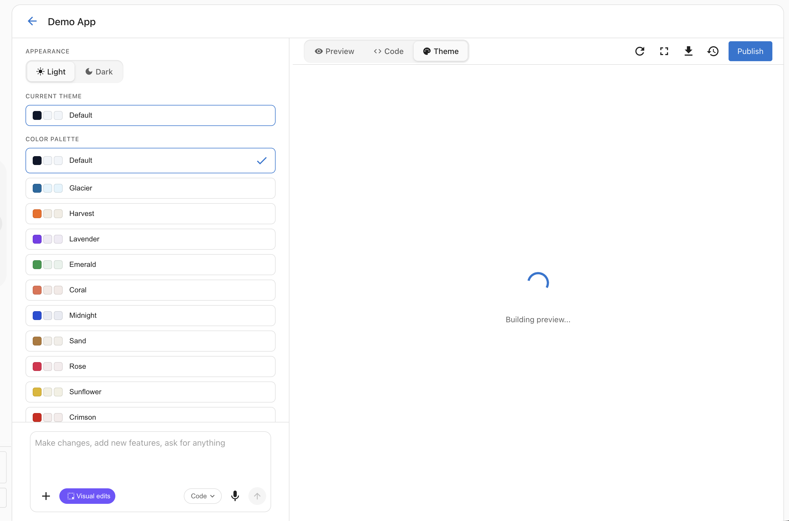

Vibe includes a visual editor that lets you customize your application's appearance without writing prompts or code. Select `Visual edits` in the chat composer to turn it on. The button turns purple, its tooltip reads "Select object to edit," and the left panel replaces the chat with "Select an element to edit." Click elements in the live preview to edit them. To go back to prompting, select `Visual edits` again.

<!-- THEMES: restore the following image and section when themes feature launches

## Theme System

Vibe uses a theme system based on HSL color variables, similar to shadcn/ui. Every generated application comes with a set of CSS variables that control colors across the entire UI — background, foreground, primary, secondary, accent, and more.

### Browsing Themes

In Design mode, the left panel shows the **Themes** tab with:

1. **Appearance toggle** — Switch between **Light** and **Dark** mode. This applies globally to your application.
2. **Current Theme** — Shows which theme is currently active.
3. **Color Palette** — A list of all available themes. Each theme shows color swatches for its primary, secondary, and accent colors.

Available themes include:
- Default, Glacier, Harvest, Lavender, Emerald, Coral, Midnight, Sand, Rose, Sunflower, Crimson, Slate, Ocean, and more.

### Applying a Theme

- **Hover** over a theme to preview it temporarily — the live preview updates instantly so you can see how it looks.
- **Click** a theme to apply it permanently to your project.

Theme changes update the `theme.css` file in your project, which defines the CSS custom properties used by all components. This means your entire application updates at once — buttons, cards, backgrounds, text, and all other elements.

### Light and Dark Mode

Every theme supports both light and dark appearances. Use the toggle at the top of the Themes panel to switch between them. The mode is saved per-project, so different projects can have different appearance settings.
-->

## Editing a specific element

Hover over an element in the live preview to see a purple outline and a tag with its selector, then click the element to select it. The left panel shows `Select parent` next to a chip with the element's selector. Click `Select parent` to walk the selection up to the containing element.

When you select an element, Vibe gets exact context about what you clicked: the source file, the line and column in that file, the JSX tag, the CSS classes, and the text content. That context travels with any prompt you send while the element is selected, so when you ask for a change Vibe edits the right element directly, without guessing from a prose description.

You can select up to ten elements at once. Vibe handles each one in the same prompt.

### Two ways to ask for a change

Once an element is selected, you have two paths:

- **Inline quick-edit**: An `Ask Vibe...` input appears next to the selection. Type a one-line change ("make this bigger and bolder," "change the color to navy") and press enter. Best for fast tweaks where you don't need to leave the canvas.
- **Chat input**: Use the chat input below the left panel for longer changes that need more context, more steps, or a follow-up question from Vibe. The selection still travels with the prompt, so Vibe knows what you're talking about.

Both paths produce the same result. Pick whichever fits the change you have in mind.

### Direct edits without the chat

For some properties you can edit the value directly in the Visual edits panel without sending a prompt.

#### Text elements
- Edit the text content directly.
- Changes are synced back to the source code.

#### Image elements
- Change the image source URL.
- Set alt text.
- Adjust object-fit and object-position.
- Configure loading behavior (lazy/eager).

#### Icon elements (Lucide icons)
- Browse and pick from 900+ Lucide icons.
- Adjust icon size.
- Change icon color.

#### Link elements
- Edit the href URL.
- Set the target (new tab, same tab).
- Configure title and rel attributes.

### Style properties

The left panel groups the controls for the selected element into these sections, in this order. `Text` appears for text elements, and `Icon` appears for icons.

| Section | Properties |
|----------|-----------|
| `Text` | Text content |
| `Icon` | Icon, size, color |
| `Layout` | Display (flex/grid), direction, justify, align, gap, wrap |
| `Colors` | Background color, text color (each with `Inherit`, a swatch, and a hex value) |
| `Spacing` | Margin, padding |
| `Typography` | Font size, font weight, font style, line height, letter spacing, alignment, decoration, transform |
| `Border` | Border settings for the selected element |
| `Effects` | Box shadow (none, sm, md, lg, xl), opacity, border radius |

All changes update the source code, so they persist and you can see them in Settings > `Code`.

## Visual editor vs. main chat

Both the visual editor and the main chat reach the same generation engine. The difference is what context travels with the prompt and how scoped the change is.

| Best for the visual editor | Best for the main chat |
|---|---|
| Targeted edits to a specific element you can see | New sections, pages, or features |
<!-- THEMES: restore this row when themes feature launches: | Theme changes across the whole app | Restructuring navigation or layout | -->
| Style tweaks across sections | Restructuring navigation or layout |
| Swapping icons, images, or alt text | Adding responsive behavior |
| Style tweaks: padding, color, font size on one element | Multi-component changes that aren't about a single element |

The visual editor is best for *small, targeted adjustments anchored to something on screen*. For structural changes or anything that doesn't start from "this thing right here," the main chat is the right entry point.

## Next steps

- [Prompting guide](./prompting.md): Write effective prompts for changes that go beyond the visual editor
- [Connectors](../connectors/index.md): Wire your app into forms, analytics, and sign-on
- [Prompting library](./prompting-library.md): Ready-made prompts for common refinements

