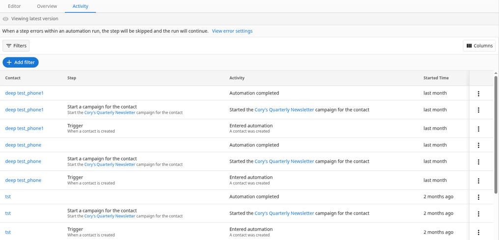

Use an automation's `Activity` tab to see what ran, when it ran, and whether it succeeded. This helps you verify outcomes and troubleshoot issues.

## Where to find it

1. Go to `Business App` → `Automations`.
2. In `My automations`, open an automation.
3. Select the `Activity` tab to review recent runs. The automation's other tabs are `Editor` and `Overview`.

A banner at the top of the `Activity` tab shows how step errors are handled, for example: "When a step errors within an automation run, the step will be skipped and the run will continue." Select `View error settings` to review the error handling settings.

## Understanding the Activity log

The `Activity` tab displays a log of every time your automation runs. Each row represents a step in the workflow and shows these columns:

- `Contact`: The contact that triggered this automation run. When the automation's trigger is based on companies, this column is `Company` instead.

- `Step`: Which part of the workflow ran. Common examples include:
  - "Trigger" (the event that started the automation)
  - "Start a campaign for the contact"
  - "Send a webhook"
  - "Create an opportunity"
  - "Send SMS"

- `Activity`: The outcome of that step. This tells you what actually happened and whether it succeeded. Common activity statuses include:
  - `Automation completed`: The run finished successfully
  - `Running`: The workflow is in progress and steps update in real time
  - `Entered automation`: The automation was triggered and started
  - `Sent webhook`, `Created opportunity`, or `Started the [campaign name] campaign for the contact`: Specific steps that completed successfully

- `Started Time`: When this step started

### Find a specific run

- Select `Filters`, then `Add filter`, to narrow the log. A filter reads "Where [field] is", and the fields are `Trigger`, `Contact` (or `Company`), and `Run`. You can also choose `Show events that didn't start` or `Only show events with errors`. Select `Apply` to filter the log.
- To see every step of a single run, select the ⋮ menu at the end of a row, then select `View all activities of this run`.

## Troubleshooting

### "My automation didn't fire"

Check these in order:

1. **Is the automation live and turned on?** In `My automations`, the automation's status must be `Live`, not `Draft`, and the switch in the automation's header must be `On`. Turn it on if needed.
2. **Did the trigger event actually occur?** Confirm the event happened (for example, the contact was created, or the form was submitted) at the time you expected.
3. **Do your conditions match?** Review the [conditions](automation-conditions.md) on your trigger. If the contact or company data doesn’t meet the criteria (for example, a tag or field value doesn’t match), the automation doesn’t start.
4. **Is the trigger configured correctly?** Ensure you chose the right event type and that any required fields are mapped.
5. **Was there an error?** Open the `Activity` tab for this automation. If needed, select `Filters` → `Add filter` to narrow the log to the right contact or run, or choose `Only show events with errors`. Then look in the `Activity` column for steps that errored or were skipped around the time the automation should have run. To check for triggers that didn't start a run, choose `Show events that didn't start`.

### "Automation ran but step failed"

1. **Check the `Activity` tab** for the automation. If needed, select `Filters` → `Add filter` and choose `Only show events with errors` to find the run. Find the run that failed, then select ⋮ → `View all activities of this run` to see each step’s activity.
2. **Identify the step that errored or was skipped.** Read the Activity details for that step; they usually explain what went wrong.
3. **Common causes:**
   - **Missing required data**: A field the step needs (for example, phone for SMS or email for email) was empty or missing.
   - **Permission or sign-in**: The connection or account used by the step may need to be re-authenticated (for example, reconnect the integration).
   - **External service issue**: The external app or service was unavailable or timed out; try again later.
   - **Invalid data format**: The value passed to the step was in the wrong format (for example, a number where text was expected). Check your field mappings.

### "Automation is stuck"

A run can stay `Running` for a while when:

- **It’s waiting for a `Wait For` condition**: The workflow is paused until something happens (for example, a meeting is booked or a field changes). Check whether that condition can still be met.
- **A delay step is still counting down**: If you added a `Wait` or delay, the run continues after the delay ends.
- **Rate limiting**: The system can temporarily pause runs when there’s heavy use. Runs usually resume automatically.

If a run stays stuck for an unusually long time, open the `Activity` tab, use `Filters` → `Add filter` to find the run if needed, then select ⋮ → `View all activities of this run`. Look for steps in the `Activity` column that are timing out or waiting on an external system. If the problem continues, note when it happened and what you see in `Activity` when you ask for help.

### General tips

- **Check data requirements:** Make sure required fields (for example, phone for SMS) exist on the record.
- **Review error handling:** In the `Editor` tab, select `Run settings`. Under `Error handling settings`, choose `Skip the step and continue the automation run`, `Stop the automation run`, or `Retry errored automations in the Activity table`. See [Automation settings](automation-settings.md).
- **Reduce noise:** Add [conditions](automation-conditions.md) so the automation runs only when needed.
- **Avoid duplicates:** In `Run settings`, under `Entry settings`, choose `Only once per contact`, `Multiple times per contact`, or `One at a time per contact`, or choose `Ignore triggers to run this automation if it's currently running`.

## Pro tips

- Test first: Trigger the automation with a test record before enabling broadly.
- Monitor early: Review `Activity` after enabling to confirm expected behavior.
- Log context: Use tags or fields so you can filter runs and outcomes later.

## Frequently asked questions

Why is my automation stuck in "Running"?

A `Running` status usually means the workflow is waiting for something, for example, a delay step, a `Wait For` condition, or an external service. See [Automation is stuck](#automation-is-stuck) above for causes and what to check.

What should I have ready when I contact support?

When asking for help with an automation, have ready: the **automation name**, **when** the issue happened (date and time), and **what you see in the Activity tab** (a screenshot of the run or failed step helps). If the problem involves a specific contact or record, note the state of that record at the time the automation ran, not just how it looks now.

