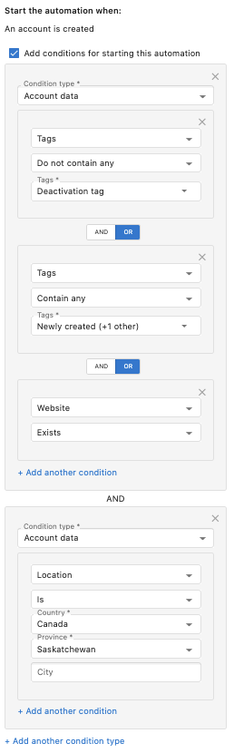

Conditions work alongside [automation triggers](automation-triggers.md) to give you precise control over when a workflow runs. Trigger conditions allow you to further filter the triggers that start your workflows. There are a number of trigger conditions you can filter on, including tags, contact fields, account location, and more.

## Add conditions to a trigger

1. In the automation's `Editor` tab, select the trigger to open its panel.
2. Select the `Add conditions for starting this automation` checkbox.
3. Choose a `Condition type`. The options depend on the trigger. For example, a trigger based on notes offers `Contact data`, `Note`, and `Workflow data`.
4. Choose a field, then an operator and a value. For example, for `Tags` you can choose `Include any:`, `Include all:`, `Do not include any:`, or `Do not include all:`.
5. To add another condition of the same type, select `+ Add another condition`. To add a group with a different condition type, select `+ Add another condition type`.

## Combine conditions with AND and OR

When you apply multiple conditions, you can specify which logical operator (`AND` or `OR`) puts them together.

### OR operator

With the `OR` operator, the trigger conditions are met when any of the conditions in the group are met. The example below uses the "An account is created" trigger. Its top group is met if the account doesn't have the Deactivation tag, `OR` it has the Newly created tag, `OR` it has a website.

### AND operator

With the `AND` operator, the trigger conditions are met only when all the conditions are met. In the example below, `AND` joins the top group and the bottom group. The trigger conditions are met if one of the conditions in the top group is met `AND` the condition in the bottom group is met.

## Field descriptions

When you choose a CRM field while building a condition, its field description appears below the field selector. For example, `Tags` shows "Descriptive keywords that help you find and segment contacts." This helps you confirm you've picked the right field, including any expected format or unit, before adding the condition. The description only appears for fields that have one set.

You can add or edit field descriptions from CRM Objects settings. See [CRM Fields](../administration/crm-objects/app_settings_crm_fields.md) for details.

## Best practices

- Use `AND` conditions when all criteria must be met
- Use `OR` conditions when any criteria can trigger the automation
- Keep conditions simple and testable
- Document complex condition logic
- Regularly review and update conditions as your business changes
