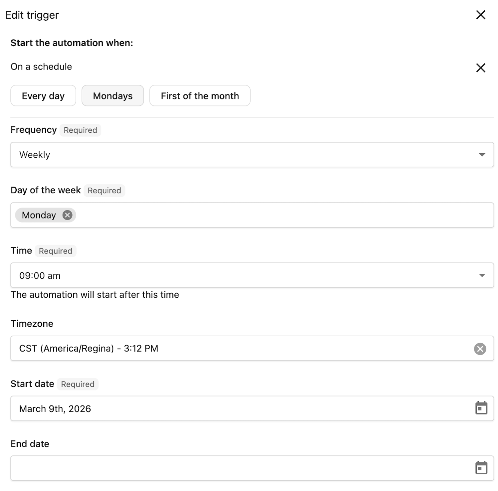

Run automations on a recurring schedule without waiting for an event to trigger them. The `On a schedule` trigger is useful for routine tasks like sending team reminders, weekly notifications, or monthly check-ins.

## How time-based triggers work

Unlike event-based triggers that run when something happens (like a company or contact creation), time-based triggers run at times you define. You set the frequency, time of day, and date range, and the automation runs automatically.

On the canvas, the `On a schedule` trigger card shows the schedule, for example "Weekly on Wednesday at 9:00 am (America/Regina)", and a `Next scheduled run` line with the date and time of the next run. You can confirm the schedule at a glance without opening the trigger panel.

**Key benefits:**
- Automate recurring tasks without manual intervention
- Run automations at optimal times for your audience
- Set start and end dates to control when the schedule is active

## Set up the On a schedule trigger

**Step 1**: Go to `Business App` → `Automations`.

**Step 2**: Click `Create automation` or open an existing automation.

**Step 3**: In the trigger picker, find the `Time-based` group and select `On a schedule`.

**Step 4**: Select a preset (`Every day`, `Mondays`, or `First of the month`) or set the schedule options yourself (see below), then select `Save`.

**Step 5**: Add your automation steps, then select `Publish` to make the automation live.

## Schedule options

Choose `Daily`, `Weekly`, or `Monthly` in the required `Frequency` field. Every schedule also needs a `Time`. The automation starts after this time.

### Daily

Run the automation at the same time every day.

| Setting | Description |
| --- | --- |
| `Time` | The time of day to run, in the timezone set in the trigger's `Timezone` field |

### Weekly

Run the automation on specific days of the week.

| Setting | Description |
| --- | --- |
| **Time** | The time of day to run |
| `Day of the week` | Select one or more days |

### Monthly

Run the automation on specific days of the month.

| Setting | Description |
| --- | --- |
| **Time** | The time of day to run |
| **Days of month** | Select one or more days (1-31) |
| **End of month** | Run on the last day of the month, regardless of how many days it has |

:::tip
Use the **End of month** option for consistent month-end notifications. This ensures the automation runs on the 28th, 30th, or 31st depending on the month.
:::

## Date boundaries

Control when your time-based automation is active.

| Setting | Description |
| --- | --- |
| `Start date` | Required. The automation starts on or after this date. |
| `End date` | Optional. The automation stops on this date. Leave it blank to run the schedule indefinitely. |

## Timezone

Choose the schedule's timezone in the trigger's `Timezone` field, for example `CST (America/Regina)`. The `Time` you enter is interpreted in this timezone, and the trigger card shows the timezone in brackets, for example "(America/Regina)".

## Example use cases

### Weekly sales task for client check-ins

Create a recurring task to reach out to a key client:
- **Frequency:** Weekly
- **Day:** Wednesday
- **Time:** 10:00 AM
- **Steps:**
  1. Find the contact
  2. Create a sales task to check in with the client

### Invoke an AI employee on a schedule

Invoke an AI employee to generate insights and share them with your team:
- **Frequency:** Daily
- **Time:** 8:00 AM
- **Steps:**
  1. Send a request to an AI employee with your prompt
  2. Send the AI response to Slack or Google Chat

## Troubleshooting

### Automation did not run at the scheduled time

- Verify the automation's status is `Live` in `My automations` and its switch is `On`
- Check that the current date is within the `Start date` and `End date` range
- Confirm the trigger's `Timezone` field is set correctly
- Check the `Next scheduled run` line on the trigger card to see when the automation runs next

### Schedule options not appearing correctly

- Ensure you have selected at least one day for weekly or monthly frequencies
- For monthly schedules, remember that selecting day 31 only runs in months with 31 days

### Automation runs at unexpected times

- Double-check the trigger's `Timezone` field
- Remember that daylight saving time changes may affect the actual run time in your local time

## Related resources

- [Triggers](automation-triggers.md)
- [Automation conditions](automation-conditions.md)
- [Automation settings](automation-settings.md)
