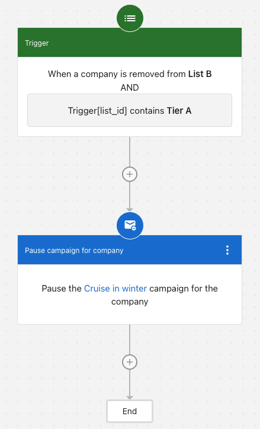

When a lead books a meeting, emails you, or drops off a target list, continuing to send campaign messages can feel irrelevant, or worse, damage the relationship. You can build automations that pause campaigns automatically when conditions change, so your outreach stays timely without manual intervention.

## When to use this

- A contact books a meeting and no longer needs nurture emails. Use the `A meeting activity is created for a contact` trigger.
- A contact emails you and should get a personal reply instead of more campaign messages. Use the `An email activity is created for a contact` trigger, and add [conditions](../automation-conditions.md) so only the emails you care about start the automation.
- A company is removed from a target list and should stop receiving campaign messages
- A lead score drops below a threshold and outreach should pause until the lead re-qualifies

## Example: Pause a campaign when a company leaves a target list

You're running a "Cruise in winter" campaign for Tier A companies. When a company is removed from List B, and that list is tagged as Tier A, you want to automatically pause the campaign for that company.

1. **Trigger:** Set the trigger to `A company is removed from a list` and select **List B**.
2. **Condition:** Add a condition where `list_id` contains **Tier A**.
3. **Action:** Add the `Pause campaign for company` step and select the **Cruise in winter** campaign.

When a company is removed from List B, the automation checks if the list ID contains "Tier A". If true, it pauses the "Cruise in winter" campaign for the entire company, stopping all campaign messages to every contact in that organization.

:::tip
Add a **Delay** step before the pause action to give leads time to re-engage before the campaign stops.
:::

## Contact-level vs. company-level pausing

| Level | Step name | When to use |
|-------|-----------|-------------|
| Contact | `Pause campaign for contact` | A specific lead takes action, such as booking a meeting or emailing you |
| Company | `Pause campaign for company` | A business as a whole goes cold or no longer qualifies, and you want to stop outreach to all associated contacts |

You can combine both in the same automation.

## Where do email stats appear?

How you send marketing email from an automation determines where you see the stats:

| Step | Where stats appear |
|------|-------------------|
| `Start a campaign for the contact` | In the campaign's reporting page, same as any other campaign send |
| `Send a marketing email template to a contact` | In the automation step itself. The email is not tied to a campaign and its stats are stored separately |

Both steps send marketing email. The difference is:

- **Start a campaign for the contact** enrolls the contact in a campaign workflow. Stats roll up to the campaign's main reporting page alongside any other sends. It sends through Campaigns, so it counts toward the Campaigns email quota and requires Campaigns Pro. The same applies to `Start a campaign for the company`.
- **Send a marketing email template to a contact** sends a standalone email directly from the automation. To see how that email performed, open the automation and inspect the step. It doesn't send through Campaigns, so it doesn't require Campaigns Pro. It does count toward your daily email sending limit, which helps prevent sending a large volume of email by accident. The same applies to `Send a marketing email template to a company`.

:::tip
If you want email performance to show up in campaign reporting, use `Start a campaign for the contact`. If you're sending a one-off email that doesn't need its own campaign, use `Send a marketing email template to a contact` and check the automation step for results.
:::
