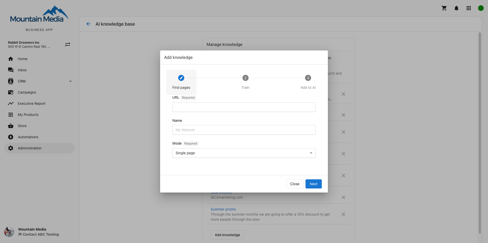

Train your AI Assistant using content from your website so it can answer questions from leads and customers accurately and automatically.

[Learn more about Conversations here](/business-app/conversations/).

## How to train your AI assistant on your website

### Requirements

- Access to Conversations AI in Business App
- A website with content you'd like the AI to learn from
- Conversations AI Pro to install the chat widget on your website and make it customer-facing

### Steps

1. Navigate to `Conversations AI` → `Conversations AI Settings` → `Web Chat Widget` and select `Configure Web Chat`.
   - If you don't see `Configure Web Chat`, first click `Try it out today` to initialize a test Web Chat demo. Reload the `Conversations AI Settings` page to see the button.
2. Go to the `AI Assistant` settings card and select `Add Knowledge`, then choose `Website`.
3. Follow the wizard to train the AI assistant on your website:
   - Enter your website URL and a `Name` that tells you at a glance what this knowledge is, such as "Our website".
   - Under `Mode`, choose how the AI finds your pages:
     - `Single page`: learns only the page at the URL you enter.
     - `Follow links`: starts at your URL and follows its links to find the public pages on your site.
     - `Sitemap`: uses your site's sitemap, so it also finds pages that nothing links to, such as standalone landing pages.
   - To leave out a section you don't want the AI to learn, such as an old blog, exclude its path.
   - Select `Enable automatic refresh` so the AI checks your website again and picks up your changes.
   - Select all the pages you'd like to train your AI on, and save.
4. To install the web chat widget on your website, make sure Conversations AI Pro is active, then follow the installation instructions.

The AI learns pages on the website you add. It doesn't follow links to other websites, such as an external booking page or a staff profile on another site. To teach the AI one of those pages, add it as its own knowledge source.

## FAQs

<strong>Why did my AI provide a certain answer?</strong>

The AI uses facts and knowledge that it's been trained on. If an answer was incorrect, it's likely that the source training data was incorrect. The most common culprit is old or incorrect information found on the website.

<strong>How long does training take?</strong>

Depending on the size of your website and how many pages the AI is trained on, it may take 1-5 minutes for the AI to begin using the new knowledge in its answers. Be patient after training a large website when testing.

<strong>Can the AI be trained on all the pages on my website?</strong>

By default, only the home page of your website will be scraped. The AI can then be trained on up to 100 pages from your website. Choose "follow links" or "sitemap" mode for finding pages to give the AI as much content as possible to answer questions for your leads and customers.

<strong>Why am I having issues with AI scraping my site?</strong>

This may be blocked in your WordPress settings. To check, navigate to `WordPress Dashboard` → `Settings` → `General` → `Privacy` and ensure that `Prevent third-party sharing for` is unchecked.

<strong>What file types are supported for uploads in the AI Knowledge Base?</strong>

The AI Knowledge Base supports a wide range of file formats (up to 100MB each). You can upload:
- PDF
- DOCX
- HTML
- Images: JPG, PNG
- TXT
- CSV
- Markdown
- JSON
- PowerPoint (PPTX)
- Excel (XLS, XLSX)

<strong>How should I upload image-based files?</strong>

If your document consists of images (e.g., scanned pages or brochures), upload each page as an image file (JPG or PNG). These formats allow the AI to extract and process text more reliably than image-based PDFs.

<iframe src="//www.youtube-nocookie.com/embed/eMTaoKXymXQ" width="560" height="315" frameBorder="0" allowFullScreen></iframe>
