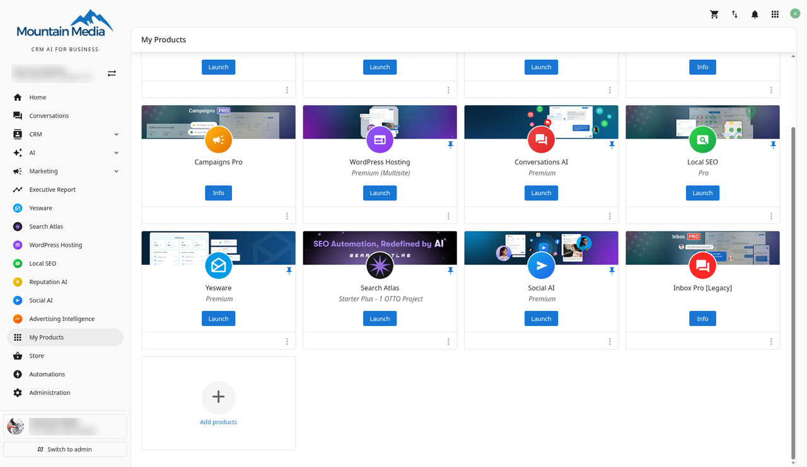
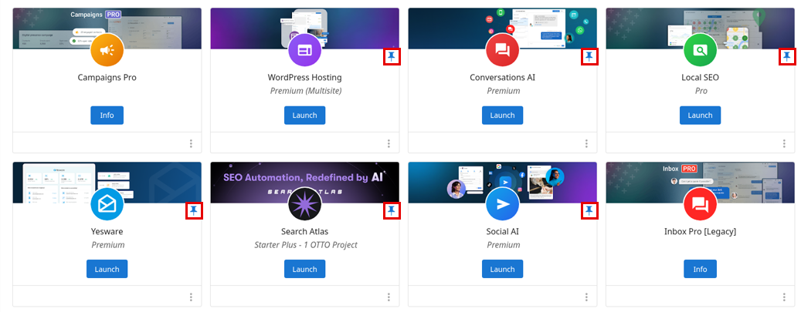
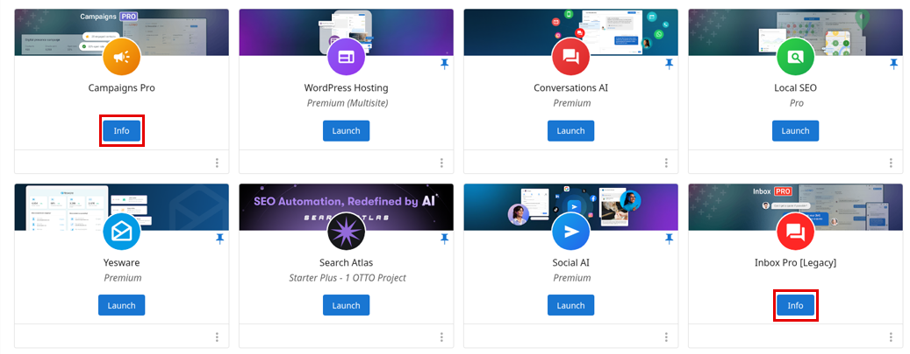

The `My Products` page lists all products and services that are active for your business. From here you can see what’s on your account and pin the products you use most to the Business App side panel.

## How does the My Products page work?

1. Log in to Business App and click `My Products`.

## How can I organize the products on the side panel?

On the `My Products` page, click the **pin icon** on the right side of a product card to choose which products appear on the Business App side panel. You can set your own pins.

## Why can't I pin a product to the side panel?

Only products you can launch can be pinned. Products that show an `Info` button instead of `Launch` appear for reference, but they don't have a pin icon.
