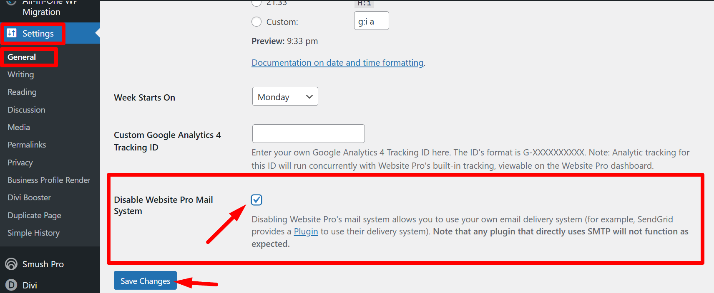

## Email statuses

When reviewing emails in the Activity section, you'll see the following statuses:

| Status | Meaning |
|--------|---------|
| **Processed** | The email has been accepted by the system. This is a combined status covering both delivered and bounced emails. |
| **Delivered** | The recipient's mail server accepted the email. The recipient's mail provider still decides where it lands, so a delivered email can end up in Junk or quarantine instead of the inbox. |
| **Bounced** | The email could not be delivered — usually due to an invalid email address or a full mailbox. |
| **Opened** | The recipient opened the email. |
| **Clicked Through** | The recipient clicked a link within the email. |
| **Spam Report** | The recipient marked the email as spam. This can negatively affect your sender reputation. |
| **Unsubscribed** | The recipient opted out of receiving future emails. See below for important details. |
| **Dropped** | The email was not sent due to prior bounces, unsubscribes, spam reports, or invalid addresses. |
| **Deferred** | The receiving server temporarily limited access. The system retries delivery for up to 72 hours. If still deferred after 72 hours, the deferral becomes a block. |

## Understanding unsubscribed emails

WordPress Hosting contact form submissions are classified as **transactional emails**. Transactional emails cannot be unsubscribed from — this prevents the loss of leads and ensures you receive every contact form submission.

If a recipient unsubscribes from other WordPress-generated emails (such as notifications or marketing emails), they can resubscribe using the same link in the original email. If they need further help managing their email preferences, direct them to your account administrator. For more information on how email preferences work, see [Email Subscription Preferences](../../business-app/administration/email/email-subscription-preferences.md).

## No email logs showing

If you don't see any logs under the Email History tab, your site is likely configured to use an external SMTP plugin (such as WP Mail SMTP) instead of the built-in mail system. When an external SMTP service handles email delivery, WordPress Hosting cannot capture or log those emails.

### How to enable the built-in mail system

1. Log in to the **WordPress Dashboard** for your site
2. Navigate to **Settings > General**
3. Locate the **Enable WordPress Hosting Mail System** option and check the box
4. Click **Save Changes**

Once enabled, all outgoing emails will be routed through the built-in email system and appear in the Email History tab.

## Form emails show as delivered but aren't in the inbox

If Email History shows a form notification as **Delivered** but the recipient can't find it, the recipient's mail provider accepted the email and then filtered it. This usually happens when the form sends from an address on your own domain (for example, `info@yourbusiness.com`), your domain has a DMARC policy of `quarantine` or `reject`, and the domain isn't yet authorized to send through Business App. The recipient's provider can't verify the email, so it moves it to Junk or quarantine, or rejects it.

### Release the emails that were filtered

1. Check the recipient's **Junk** or **Spam** folder
2. If the mailbox is on Microsoft 365 or Google Workspace, ask the mailbox administrator to check the quarantine and release the form emails
3. Mark the released emails as **Not junk** so future notifications are more likely to reach the inbox

### Stop it from happening again

Authorize your domain so that the recipient's mail provider can verify your form emails:

1. In Business App, go to `Administration` → `Email configuration`
2. Use `Authorize a domain` to add the domain your forms send from
3. Add the SPF, DKIM, and DMARC records shown there at your domain provider
4. Wait for the records to show as verified

For step-by-step instructions, see [Email Configuration](../../business-app/administration/email/email-configuration.mdx).

## Deferred emails

A deferred status means the receiving server temporarily limited access — similar to a busy signal. Common reasons include:

* The inbox provider is seeing too many spam complaints for email that has already been delivered
* The receiving server is experiencing technical issues

The built-in email system automatically retries delivery for up to **72 hours**. If the message is still deferred after that period, the deferral becomes a **block**. Otherwise, it results in a successful delivery once the receiving server accepts the message.

## Frequently Asked Questions (FAQs)

Does WordPress Hosting require an SPF record?

No, an SPF record is **not required** to connect or launch a site with WordPress Hosting.

The only DNS records you need are:

* **A Record** — Name: `@` or your domain name, Value: `34.149.86.124`
* **CNAME Record** — Name: `www`, Value: `host.websiteprohosting.com`

SPF, DKIM, and DMARC records aren't needed to launch your site, but they matter for email. If your forms send from an address on your own domain, authorize that domain in `Administration` → `Email configuration`. If your domain has a DMARC policy of `quarantine` or `reject`, form emails from an unauthorized domain are likely to land in Junk or quarantine, or be rejected. See [Form emails show as delivered but aren't in the inbox](#form-emails-show-as-delivered-but-arent-in-the-inbox).

Why are emails bouncing after I migrated my website?

This is often caused by missing email domain settings during the migration process.

**To fix:**

1. Go to your site's **WordPress Dashboard**
2. Navigate to **Plugins > Add New**
3. Search for and install **All-in-One WP Migration**
4. After activation, go to the plugin's menu and choose **Export > Advanced Options**
5. Select **"Do not replace email domain (SQL)"**

This prevents the migration tool from incorrectly rewriting email addresses, which is a common cause of bounced messages after import.

Can I use my own SMTP service instead of the built-in mail system?

Yes. You can use an external SMTP plugin (like WP Mail SMTP) to route emails through your own provider (e.g., Gmail, Mailgun, Amazon SES). However, emails sent through external SMTP services will **not** appear in the Email History tab — only emails routed through the built-in email system are logged.

How do I send emails on WordPress Hosting Premium (Multisite)?

WordPress Hosting Premium includes the same built-in email system as single-site installations. Form-fill and other notification emails — including submissions from Keap and Gravity Forms — are sent and logged automatically, with no setup required.

All outgoing email for a Multisite network is sent from the network's primary domain, not from individual subsites. You can still configure a custom SMTP service (such as WP Mail SMTP with Gmail, Mailgun, or Amazon SES) if you prefer to route email through your own provider, but emails sent through external SMTP services will not appear in the Email History tab.

